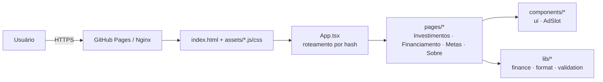
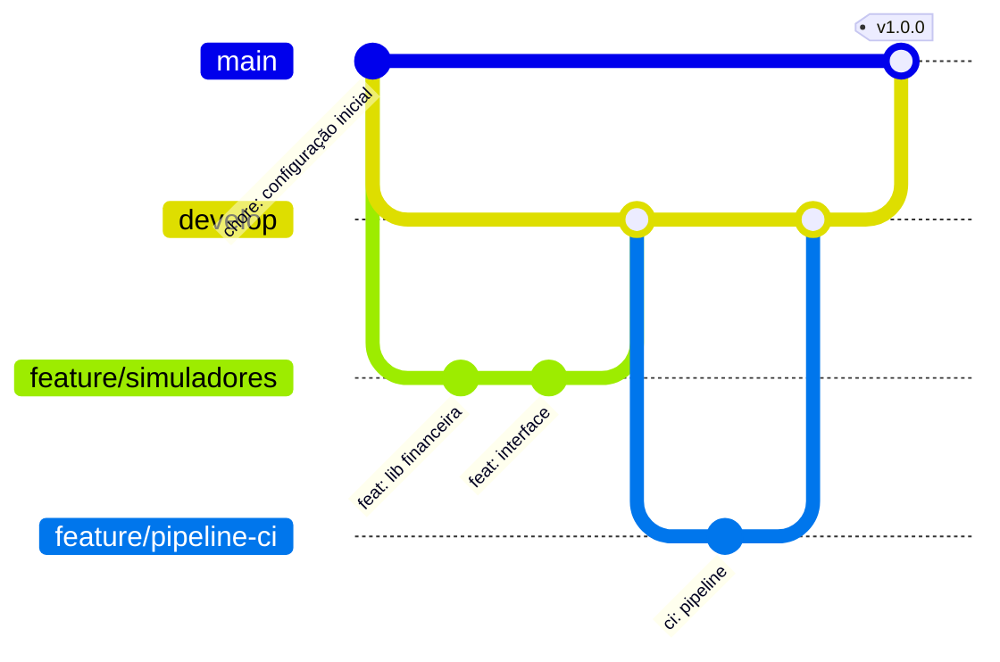
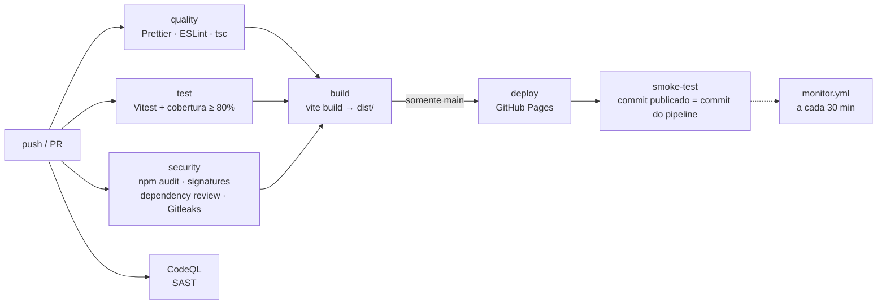

# SimulaFácil

[](https://github.com/AlmadaAlmada/icsimula/actions/workflows/ci.yml)
[](https://github.com/AlmadaAlmada/icsimula/actions/workflows/codeql.yml)
[](https://github.com/AlmadaAlmada/icsimula/actions/workflows/monitor.yml)
[](https://github.com/AlmadaAlmada/icsimula/actions/workflows/docker.yml)

> Simuladores financeiros gratuitos (investimentos, financiamento SAC × Price e metas), entregues por um pipeline de CI/CD completo: qualidade, testes, segurança, build, deploy, monitoramento e Docker.

| Entrega                  | Link                                     |
| ------------------------ | ---------------------------------------- |
| 🌐 Aplicação publicada   | https://almadaalmada.github.io/icsimula/ |
| 📦 Repositório           | https://github.com/AlmadaAlmada/icsimula |
| 🎬 Vídeo de apresentação | _adicionar link do vídeo_                |

---

## 1. Sobre o projeto

Trabalho final da disciplina de **Integração Contínua**. A aplicação é intencionalmente simples; o foco é o **processo** que a valida e entrega:

```
Código → Git → Pipeline → Testes → Qualidade → Segurança → Build → Deploy → Aplicação publicada → Monitoramento
```

## 2. Serviço proposto

Muita gente toma decisões financeiras (financiar um imóvel, começar a investir, juntar para uma meta) sem conseguir comparar cenários. O **SimulaFácil** responde, em segundos e sem cadastro:

- Quanto meu dinheiro rende com aportes mensais?
- SAC ou Price: qual financiamento sai mais barato e quanto economizo?
- Quanto preciso guardar por mês para chegar a R$ X em N anos?

**Monetização prevista (não implementada):** a interface reserva três espaços publicitários (topo 728×90, lateral 300×250, rodapé 970×90), adequados a anúncios de bancos, corretoras e financeiras — público com alta intenção de compra. Componente: [`src/components/AdSlot.tsx`](src/components/AdSlot.tsx).

## 3. Funcionalidades

| Página        | Rota              | O que faz                                                                                                             |
| ------------- | ----------------- | --------------------------------------------------------------------------------------------------------------------- |
| Investimentos | `#/investimentos` | Juros compostos com valor inicial + aportes mensais; evolução ano a ano e composição investido × juros                |
| Financiamento | `#/financiamento` | Compara **SAC** e **Price**: 1ª e última parcela, total de juros, total pago, veredito de economia e tabela mês a mês |
| Metas         | `#/meta`          | Calcula o aporte mensal necessário para atingir um objetivo                                                           |
| Sobre         | `#/sobre`         | Aviso legal e **versão/commit publicados** (rastreabilidade do deploy)                                                |

Também: validação de campos com mensagens acessíveis, aceita números no formato brasileiro (`1.234,56`), tema claro/escuro automático e layout responsivo.

## 4. Tecnologias utilizadas

| Área                    | Ferramenta                                                                                                  | Por quê                                                     |
| ----------------------- | ----------------------------------------------------------------------------------------------------------- | ----------------------------------------------------------- |
| Aplicação               | React 18 + TypeScript                                                                                       | Componentização e tipagem estática                          |
| Build                   | Vite                                                                                                        | Build rápido, gera artefato estático otimizado              |
| Testes                  | Vitest + Testing Library + jsdom                                                                            | Testes unitários e de interface; cobertura V8               |
| Lint / análise estática | ESLint 9 (`typescript-eslint` strict, `security`, `jsx-a11y`, `react-hooks`), TypeScript `strict`, Prettier | Padrões de código, bugs, acessibilidade e padrões inseguros |
| CI/CD                   | GitHub Actions                                                                                              | Integrado ao repositório, gratuito para repositório público |
| SAST                    | GitHub CodeQL                                                                                               | Análise semântica de fluxo de dados (XSS, injeções etc.)    |
| Dependências            | `npm audit`, `npm audit signatures`, Dependency Review, Dependabot                                          | Vulnerabilidades, integridade e atualização contínua        |
| Secrets                 | Gitleaks + GitHub Secret Scanning / Push Protection                                                         | Detecta credenciais no código e em todo o histórico         |
| Hospedagem              | GitHub Pages                                                                                                | Gratuito, HTTPS, deploy oficial via Actions                 |
| Monitoramento           | GitHub Actions agendado + script Node                                                                       | Sem serviços externos                                       |
| Container (bônus)       | Docker multi-stage + Nginx não-root, GHCR, Grype                                                            | Imagem pequena, segura e publicada automaticamente          |

## 5. Arquitetura da aplicação

SPA 100% estática, sem backend: todos os cálculos rodam no navegador.



```
src/
├── lib/              # Regras de negócio puras (sem React) → maior parte dos testes
│   ├── finance.ts    # juros compostos, Price, SAC, aporte para meta
│   ├── format.ts     # moeda/percentual pt-BR e parsing de números
│   └── validation.ts # validação genérica de formulários
├── hooks/useHashRoute.ts  # roteamento por hash (funciona em qualquer hospedagem estática)
├── components/       # NumberField, StatCard, CompositionBar, Card, AdSlot
├── pages/            # uma página por simulador
├── buildInfo.ts      # versão/commit/data injetados no build
└── App.tsx
scripts/
├── smoke-test.mjs          # health check usado no pós-deploy, no Docker e no monitoramento
└── configurar-github.sh    # configuração do repositório como código (Pages, segurança, proteção)
```

**Decisões:** roteamento por **hash** evita 404 ao recarregar páginas no GitHub Pages; a lógica financeira isolada em `lib/` é testável sem DOM; o build gera `version.json` para que o pipeline e o monitoramento saibam **qual commit está no ar**.

## 6. Estratégia de branches e versionamento

Usamos um **Git Flow simplificado**:



| Branch               | Papel                                                                    | Proteção                                             | O pipeline faz                                                 |
| -------------------- | ------------------------------------------------------------------------ | ---------------------------------------------------- | -------------------------------------------------------------- |
| `main`               | Produção — tudo aqui é publicado                                         | PR obrigatório + checks obrigatórios, sem force push | CI completo **+ deploy + smoke test** + imagem Docker `latest` |
| `develop`            | Integração das funcionalidades                                           | PR obrigatório + checks obrigatórios                 | CI completo (sem deploy)                                       |
| `feature/*`, `fix/*` | Uma mudança por branch, criada a partir de `develop`                     | —                                                    | CI completo no PR                                              |
| `hotfix/*`           | Correção urgente a partir de `main`, depois mesclada também em `develop` | —                                                    | CI completo no PR                                              |

**Fluxo de trabalho**

1. `git switch develop && git switch -c feature/minha-mudanca`
2. Commits seguindo **[Conventional Commits](https://www.conventionalcommits.org/pt-br/)** (`feat:`, `fix:`, `ci:`, `docs:`, `test:`, `chore:`).
3. PR para `develop` → o pipeline precisa ficar verde para o merge ser liberado.
4. Release: PR `develop → main` → merge dispara o deploy.
5. Versão: **SemVer** em `package.json` + tag `vX.Y.Z` na `main` → workflow `release.yml` cria o GitHub Release com o artefato e o `docker.yml` publica a imagem com a tag da versão.

```bash
npm version minor --no-git-tag-version   # 1.0.0 → 1.1.0 (em uma branch, via PR)
# após o merge na main:
git switch main && git pull && git tag v1.1.0 && git push origin v1.1.0
```

## 7. Pipeline CI/CD

Workflows em [`.github/workflows/`](.github/workflows):

| Workflow                                       | Gatilho                               | Responsabilidade                                             |
| ---------------------------------------------- | ------------------------------------- | ------------------------------------------------------------ |
| [`ci.yml`](.github/workflows/ci.yml)           | push/PR em `main` e `develop`, manual | Qualidade → testes → segurança → build → deploy → smoke test |
| [`codeql.yml`](.github/workflows/codeql.yml)   | push/PR, semanal                      | SAST                                                         |
| [`monitor.yml`](.github/workflows/monitor.yml) | a cada 30 min, manual                 | Health check da aplicação publicada                          |
| [`docker.yml`](.github/workflows/docker.yml)   | push na `main`, tags, PR              | Imagem Docker: build, teste, scan, publicação                |
| [`release.yml`](.github/workflows/release.yml) | tag `v*.*.*`                          | GitHub Release com artefato versionado                       |



**Por que uma falha interrompe a publicação:** `build` declara `needs: [quality, test, security]` e `deploy` declara `needs: build`. Qualquer erro de formatação, lint, tipo, teste, cobertura abaixo do limite, dependência vulnerável ou segredo encontrado faz o job falhar, e os jobs seguintes são **pulados** — a versão inválida nunca chega ao GitHub Pages. Além disso, a proteção de branch impede o merge de PRs com checks vermelhos.

Outras práticas: `npm ci` com lockfile (build reprodutível), cache do npm, `concurrency` (cancela execuções obsoletas e serializa deploys), `permissions` mínimas por job, resumos no **Job Summary** (cobertura, arquivos do artefato, resultado do smoke test).

## 8. Testes automatizados

```bash
npm test                # executa todos os testes
npm run test:coverage   # com relatório de cobertura (coverage/index.html)
```

| Arquivo                      | Tipo            | Cobre                                                                                                                              |
| ---------------------------- | --------------- | ---------------------------------------------------------------------------------------------------------------------------------- |
| `lib/finance.test.ts`        | Unitário        | Conversão de taxas, Price, SAC, juros compostos, meta; casos de borda (taxa zero, prazo inválido) e comparação com fórmula fechada |
| `lib/format.test.ts`         | Unitário        | Formatação BRL/percentual e parsing `1.234,56`                                                                                     |
| `lib/validation.test.ts`     | Unitário        | Campo vazio, mínimo, máximo, inteiro                                                                                               |
| `hooks/useHashRoute.test.ts` | Unitário/hook   | Rotas válidas, inválidas e reação ao `hashchange`                                                                                  |
| `components/ui.test.tsx`     | Componente      | Acessibilidade (`aria-describedby`) e composição                                                                                   |
| `App.test.tsx`               | Integração (UI) | Navegação, digitação do usuário, mensagens de erro, tabela de parcelas, veredito SAC × Price                                       |

**Critério automatizado de qualidade:** `vite.config.ts` define limites mínimos — linhas/funções/statements **80%**, branches **75%**. Abaixo disso o Vitest sai com erro e o pipeline para. Cobertura atual: **~98%** (66 testes). O relatório (HTML + LCOV + JUnit) é publicado como artefato `test-reports` em cada execução.

## 9. Qualidade de código

```bash
npm run format:check  # Prettier
npm run lint          # ESLint, zero warnings tolerados (--max-warnings=0)
npm run typecheck     # TypeScript strict
npm run validate      # tudo + testes + build (o mesmo que o pipeline faz)
```

Configuração em [`eslint.config.js`](eslint.config.js):

- `typescript-eslint` **strict** — análise estática de tipos e más práticas;
- `eslint-plugin-security` — padrões inseguros (`eval`, regex vulnerável a ReDoS, acesso dinâmico a objetos);
- `eslint-plugin-jsx-a11y` — acessibilidade;
- `react-hooks` — regras de hooks;
- métricas: `complexity ≤ 12`, `max-depth ≤ 3`, `eqeqeq`, proibição de `console.log`.

Supressões pontuais de regra são sempre comentadas com a justificativa no próprio código.

## 10. Segurança

| Requisito                                      | Como é atendido                                                                                                                                                                           | Onde                       | Justificativa da ferramenta                                                                                     |
| ---------------------------------------------- | ----------------------------------------------------------------------------------------------------------------------------------------------------------------------------------------- | -------------------------- | --------------------------------------------------------------------------------------------------------------- |
| **SAST**                                       | CodeQL com `security-extended` + `security-and-quality` para JS/TS **e para os próprios workflows**                                                                                       | `codeql.yml`               | Nativo do GitHub, gratuito em repo público, análise de fluxo de dados; resultados em _Security → Code scanning_ |
| SAST leve no lint                              | `eslint-plugin-security`                                                                                                                                                                  | `ci.yml` (quality)         | Feedback rápido, roda também localmente                                                                         |
| **Análise de dependências / vulnerabilidades** | `npm audit --audit-level=high` (falha o pipeline)                                                                                                                                         | `ci.yml` (security)        | Base de advisories do GitHub, sem configuração                                                                  |
|                                                | Dependency Review em PRs (bloqueia dependência nova com vulnerabilidade alta ou licença GPL/AGPL)                                                                                         | `ci.yml`                   | Analisa apenas o _diff_ do PR                                                                                   |
|                                                | Dependabot (npm, GitHub Actions e imagem Docker)                                                                                                                                          | `dependabot.yml`           | Atualizações viram PRs que passam pelo pipeline                                                                 |
| **Secret scanning**                            | Gitleaks em **todo o histórico** (`fetch-depth: 0`)                                                                                                                                       | `ci.yml` (security)        | Open source, +150 tipos de segredos, roda igual localmente                                                      |
|                                                | GitHub Secret Scanning + **Push Protection**                                                                                                                                              | configuração do repo       | Bloqueia o push antes de o segredo entrar no histórico                                                          |
| **Uso adequado de secrets/variáveis**          | Nenhuma credencial no código. Deploy usa OIDC (`id-token`), GHCR usa o `GITHUB_TOKEN` efêmero, URL do monitor é uma _variável_ (`vars.APP_URL`), `.env*` no `.gitignore`                  | todos                      | Sem segredos de longa duração para vazar                                                                        |
| **Cadeia de suprimentos**                      | Actions fixadas por **SHA de commit**; `permissions` mínimas por job; `npm ci` + lockfile; `npm audit signatures`; atestado de proveniência (SLSA) no release e na imagem; SBOM da imagem | todos                      | Mitiga tags de actions comprometidas e pacotes adulterados                                                      |
| Container                                      | Imagem final sem Node/código-fonte, usuário não-root, scan **Grype** (falha em vulnerabilidade crítica com correção), cabeçalhos CSP/X-Frame-Options no Nginx                             | `Dockerfile`, `docker.yml` |                                                                                                                 |

Política para reportar vulnerabilidades: [`SECURITY.md`](SECURITY.md).

**Teste rápido do secret scanning:** em uma branch, crie um arquivo com `AWS_SECRET_ACCESS_KEY=AKIA...` (um valor falso no formato real) e abra o PR — o job _Segurança_ falha no passo Gitleaks (e o Push Protection pode até bloquear o push).

## 11. Build e artefatos

**Como o build é feito:** `npm run build` → Vite compila TypeScript/JSX, empacota e minifica JS/CSS e gera nomes com _hash_ de conteúdo. No pipeline, `BASE_PATH=/<repositorio>/` ajusta os caminhos para o GitHub Pages.

**Em que etapa:** job `build` do `ci.yml`, **somente depois** de `quality`, `test` e `security` passarem.

**O que compõe o artefato (`dist/`):**

```
dist/
├── index.html              # ponto de entrada da SPA
├── 404.html                # cópia do index (fallback de SPA no Pages)
├── favicon.svg
├── version.json            # { version, commit, builtAt, status } — rastreabilidade
├── SHA256SUMS              # checksums de integridade de todos os arquivos
└── assets/
    ├── index-<hash>.js     # ~155 kB (≈50 kB gzip)
    └── index-<hash>.css
```

**Como é usado na publicação:**

1. `upload-artifact` guarda `icsimula-dist-<sha>` por 30 dias (download na aba _Actions_);
2. `upload-pages-artifact` empacota **o mesmo `dist/`**, e `deploy-pages` publica exatamente esse pacote — não há rebuild no deploy ("build once, deploy the same");
3. Em tags, `release.yml` anexa `icsimula-vX.Y.Z.zip` + `.sha256` + atestado de proveniência ao GitHub Release;
4. O `Dockerfile` usa o mesmo comando de build e copia `dist/` para o Nginx.

## 12. Deploy

- **Hospedagem:** GitHub Pages, origem **GitHub Actions** (sem branch `gh-pages`).
- **Quando:** todo push/merge na `main` com pipeline verde. PRs e `develop` nunca publicam.
- **Como:** job `deploy` → `actions/deploy-pages` autenticado via OIDC, no ambiente `github-pages` (histórico de deploys em _Deployments_).
- **Verificação:** job `smoke-test` acessa a URL publicada e confirma que o `commit` em `version.json` é o commit do pipeline — prova de que a versão nova está realmente no ar.
- **Rollback:** reverter o commit na `main` (`git revert`) via PR, ou re-executar o workflow de um commit anterior.

### Rodar localmente

```bash
nvm use            # Node 22
npm ci
npm run dev        # http://localhost:5173
npm run validate   # o mesmo que o CI
```

### Configurar o repositório no GitHub

As configurações do repositório também são versionadas como código. Com o [GitHub CLI](https://cli.github.com/) autenticado (`gh auth login`):

```bash
bash scripts/configurar-github.sh             # Pages, Dependabot, Secret Scanning/Push Protection, variável APP_URL
bash scripts/configurar-github.sh --proteger  # + proteção de main e develop (PR e checks obrigatórios)
```

## 13. Monitoramento e observabilidade

```
GitHub Actions (cron */30) → https://almadaalmada.github.io/icsimula/ → Health check → ✅ Sucesso / ❌ Falha → Issue automática
```

Workflow [`monitor.yml`](.github/workflows/monitor.yml) + script [`scripts/smoke-test.mjs`](scripts/smoke-test.mjs):

| Verificação     | Considera disponível quando                                                         |
| --------------- | ----------------------------------------------------------------------------------- |
| HTTP            | página inicial responde **200** em até 15 s                                         |
| Conteúdo        | HTML contém `SimulaFácil` e o container `#root`                                     |
| Assets          | o bundle JavaScript referenciado no HTML responde 200 (pega deploy "meio quebrado") |
| Saúde da versão | `version.json` responde com `"status": "ok"`; registra versão e commit no ar        |

- **Novas tentativas:** 3 tentativas com 20 s de intervalo antes de declarar falha (evita alarme falso por instabilidade momentânea).
- **Registro:** cada execução fica no histórico do Actions com tabela no _Job Summary_ (tempo de resposta, versão, resultado de cada verificação).
- **Alerta:** se falhar, abre uma **issue** com label `incidente` (ou comenta na já aberta) e o GitHub notifica por e-mail; quando a aplicação volta, a issue é **fechada automaticamente** com o link da execução.
- **Execução manual:** _Actions → Monitoramento → Run workflow_ (aceita outra URL — informe uma URL inexistente para demonstrar a detecção de falha).

**Diferença de responsabilidades:** o _CI/CD_ responde "esta nova versão pode ser entregue?"; o _monitoramento_ responde "a versão que já está no ar continua funcionando?".

> Observação: o GitHub pode atrasar alguns minutos as execuções agendadas e desativa _schedules_ de repositórios sem atividade por 60 dias.

## 14. Docker (bônus)

[`Dockerfile`](Dockerfile) multi-stage:

1. **build** — `node:22-alpine`, `npm ci` e `npm run build`;
2. **runtime** — `nginx-unprivileged:alpine` (usuário não-root, porta 8080) com apenas o `dist/`, [`docker/nginx.conf`](docker/nginx.conf) com fallback de SPA, cache de assets, cabeçalhos de segurança e endpoint `/healthz` usado pelo `HEALTHCHECK`.

```bash
docker build -t icsimula .
docker run --rm -p 8080:8080 icsimula         # http://localhost:8080
# ou a imagem publicada:
docker run --rm -p 8080:8080 ghcr.io/almadaalmada/icsimula:latest
```

Pipeline [`docker.yml`](.github/workflows/docker.yml): build com cache → sobe o container e aguarda `healthy` → **smoke test** no container → scan **Grype** → (na `main`/tags) push para o **GHCR** com tags `latest`, `sha-xxxxxxx` e `X.Y.Z`, **SBOM**, proveniência e atestado. Em PRs a imagem é construída e testada, mas não publicada.

## 15. Evidências

> Preencha com prints/links reais após as primeiras execuções (sugestão: salvar imagens em `docs/evidencias/`).

| Evidência                               | Onde encontrar                                                               |
| --------------------------------------- | ---------------------------------------------------------------------------- |
| Pipeline completo verde (grafo de jobs) | _Actions → CI/CD_ → execução na `main`                                       |
| Pipeline barrando PR com teste quebrado | PR de demonstração com check vermelho e merge bloqueado                      |
| Cobertura de testes                     | _Job Summary_ do job "Testes e cobertura" + artefato `test-reports`          |
| Alertas de SAST                         | _Security → Code scanning_                                                   |
| Secret scanning                         | log do passo Gitleaks / PR de demonstração                                   |
| Artefato de build                       | artefato `icsimula-dist-<sha>` na execução + Release `v1.0.0`                |
| Deploy                                  | _Deployments → github-pages_ + versão/commit no rodapé da aplicação          |
| Monitoramento                           | _Actions → Monitoramento_ (execuções agendadas) + issue `incidente` de teste |
| Imagem Docker                           | _Packages_ do repositório (GHCR)                                             |
| Histórico Git                           | _Insights → Network_ e lista de PRs fechados                                 |
